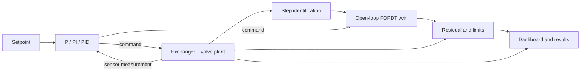
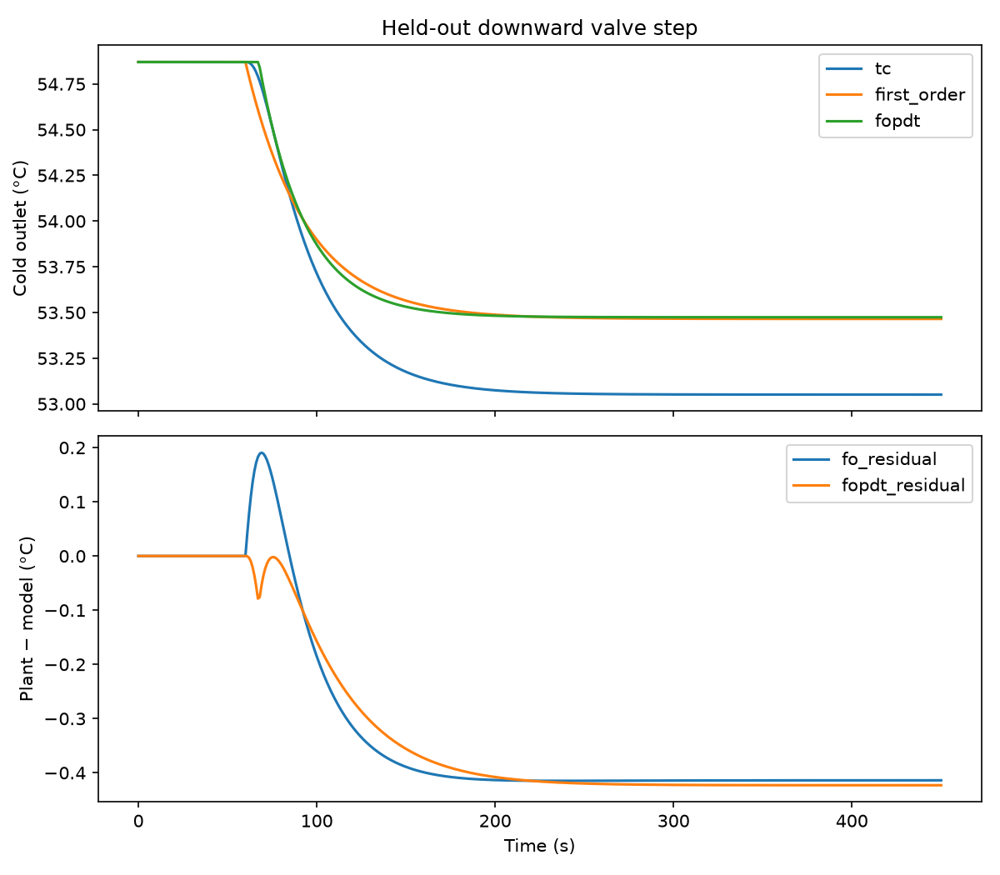
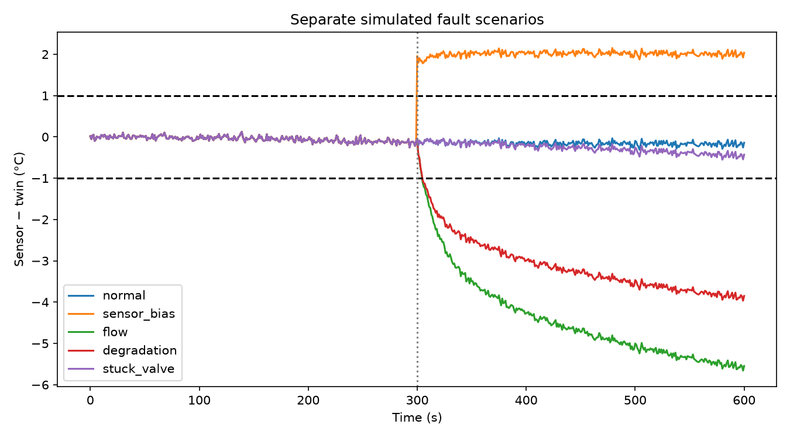

# HEATWIN — Heat Exchanger Digital Twin with PID Control

HEATWIN is a software-only undergraduate process-dynamics project for NIT Jalandhar. It simulates a water-to-water exchanger, fits empirical models, compares P/PI/PID control, predicts with a separate digital twin, and illustrates residual-based monitoring. Parameters and results are simulated; no physical equipment or measured plant data were used.



## Setup and demonstration

Python 3.12 is the tested environment. The lock file records the tested dependency versions; the package declares Python 3.11+ but other environments have not been independently checked.

```bash
git clone https://github.com/shanmukhdatta/HEATWIN.git
cd HEATWIN
python -m venv .venv
source .venv/bin/activate  # Windows: .venv\Scripts\activate
pip install -r requirements-lock.txt
pip install --no-deps .
python -m pytest -q
ruff check .
ruff format --check .
python -m scripts.experiments
python -m scripts.studies
streamlit run app.py
```

The dashboard exposes the plant UA, setpoint, gains, controller type, tuning, sensor noise, fault selection and residual threshold. Run a scenario to see temperatures, valve command and actual position, P/PI/PID metrics, twin residuals, alarms and CSV export. The scripts regenerate CSV, figures and summaries under `results/`; `configs/default.json` sets plant parameters for the baseline experiments. Studies use the nominal parameters and record configuration, seeds, gains and fault settings in code and the results summary. Run commands from the repository root.

## Engineering approach

The plant has two perfectly mixed thermal states and a first-order valve. For constant properties and no heat loss:

```text
rho Vc cp dTc/dt = mc cp (Tc,in − Tc) + UA (Th − Tc)
rho Vh cp dTh/dt = mh cp (Th,in − Th) − UA (Th − Tc)
tau_v dx/dt = clip(u,0,1) − x
mh = mh_min + (mh_max − mh_min) clip(x,0,1)
```

The default configuration uses water-like properties, UA 350 W/K and inlet temperatures 30 and 80 °C. An analytic equilibrium and energy conservation are tested. A sampled parallel controller implements filtering, saturation, anti-windup and manual-to-auto initialization. Manual, Ziegler–Nichols, Cohen–Coon, IMC and bounded model-based optimization are compared where the FOPDT assumptions apply. The twin is fitted on one valve step and evaluated on different inputs. Residuals flag anomalies, not fault identities. See [engineering notes](docs/engineering.md) for equations, units, formulas, metric definitions and limitations.

## Results from the included simulations

The default setpoint test yields the following manual-gain results; full precision is in [summary.json](results/summary.json).

| Controller | IAE (°C s) | Final error (°C) | Settling (s) |
|---|---:|---:|---:|
| P | 740.58 | 1.340 | Not reached |
| PI | 162.30 | 0.0081 | 361 |
| PID | 162.35 | 0.0078 | 358 |

The separate downward-step validation has RMSE 0.356 °C for the first-order model and 0.353 °C for FOPDT. In the individual fault studies, the example threshold detected sensor bias after 2 s, drift after 114 s, flow change after 7 s and UA degradation after 7 s. The stuck-valve case was **not detected** within the horizon. Ten normal-noise seeds generated no alarms at the chosen threshold; this small sample does not establish a false-alarm probability. More results, including tuning and disturbance rejection, are in [the study summary](results/studies/summary.json).





## Limitations and future work

This is a lumped, constant-property simulation, not a distributed exchanger design or an experimentally validated industrial twin. Identification is local and based on simulated data; one step cannot provide credible parameter confidence intervals. Faults and unmeasured disturbances can produce similar residuals; the detector misses the shown stuck-valve case and must not be used for safety decisions. Stability and robustness are assessed only through the included finite-horizon simulations, not proved across all conditions. Physical measurements, richer excitation, sensor dynamics, confidence intervals, more varied faults and independent validation would be needed for deployment. The [completion checklist](COMPLETION_CHECKLIST.md) records verification evidence and any remaining delivery work. The older [implementation plan](IMPLEMENTATION_PLAN.md) is historical.
