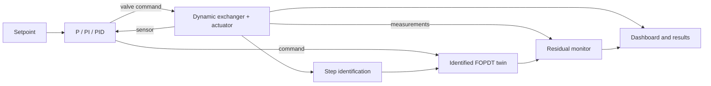
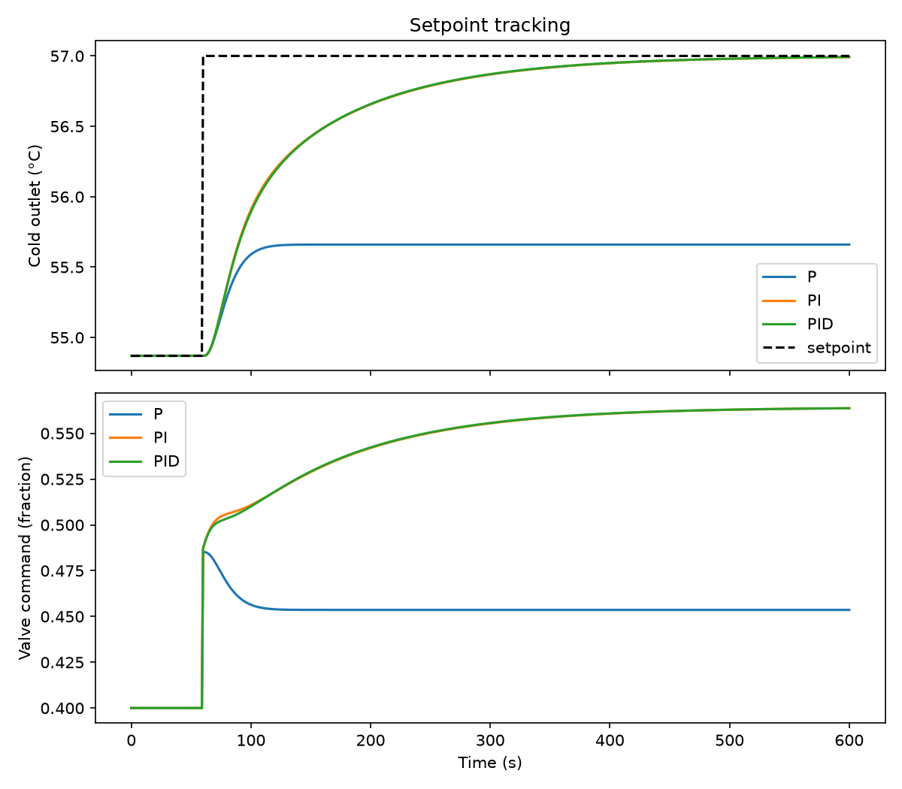
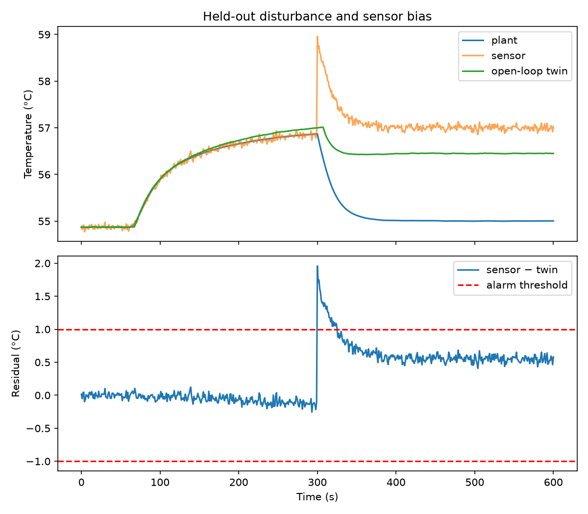

# HEATWIN — Heat Exchanger Digital Twin with PID Control

A software-only undergraduate process-control prototype for NIT Jalandhar. The data and parameters are illustrative simulations, not measurements from equipment. The repository currently contains a working baseline; the remaining work listed below is required before calling the full project complete.



## Model and assumptions

Two perfectly mixed water volumes exchange heat, with constant properties, constant effective UA, no ambient loss, no phase change and no hydraulic model. Outlet temperatures equal the lump temperatures. With temperatures in °C, flow in kg/s, time in s, and UA in W/K:

```text
rho Vc cp dTc/dt = mc cp (Tc,in − Tc) + UA (Th − Tc)
rho Vh cp dTh/dt = mh cp (Th,in − Th) − UA (Th − Tc)
tau_v dx/dt = clip(u,0,1) − x
mh = mh_min + (mh_max − mh_min) clip(x,0,1)
```

Nominal `rho=1000 kg/m³`, `cp=4180 J/(kg K)`, each volume `0.001 m³`, `UA=350 W/K`, `mc=0.03 kg/s`, inlet temperatures 30 and 80 °C, hot flow range 0.01–0.1 kg/s, valve time constant 4 s. The solver uses SciPy RK45 with a 1 s sampled control interval. The controller uses error = setpoint − measurement, parallel gains, filtered derivative on measurement, output clipping and conditional integration. Gains use fraction/°C, fraction/(°C s), and fraction s/°C respectively. Initial bias is 0.4. This is not a certified controller or safety instrument.

The FOPDT model is fitted to a nominal 0.4 → 0.5 valve step only. The twin uses step superposition and observed valve *command*, not hidden plant states; it does not model inlet disturbances. Its held-out closed-loop scenario includes a cold-inlet step and sensor bias simultaneously, so its residual alarm detects an anomaly but cannot identify its cause. Threshold: 1 °C for three consecutive samples. The simple temperature limit in the dashboard is illustrative.

## Install and run

Python 3.11 or newer:

```bash
git clone https://github.com/shanmukhdatta/HEATWIN.git
cd HEATWIN
python -m venv .venv
source .venv/bin/activate  # Windows: .venv\Scripts\activate
pip install '.[dev]'
python -m pytest -q
python -m scripts.experiments
streamlit run app.py
```

The experiment command generates CSV, PNG and JSON files in `results/`. The dashboard runs the same simulation module, accepts gains, UA, setpoint, noise and fault settings, plots plant and twin, and exports CSV. No network connection is required after installation.

## Results

The checked-in [summary](results/summary.json) and figures are generated by `python -m scripts.experiments` using seed 42. For the default setpoint test, P / PI / PID IAE values are approximately 740.58 / 162.30 / 162.35 °C s. The corresponding final errors are 1.340 / 0.0081 / 0.0078 °C. These gains are manual examples, not optimized designs. The fitted gain is 13.95 °C per valve fraction, time constant 25.83 s, effective delay 7.45 s. Training RMSE is 0.0073 °C. In the separate closed-loop run, twin RMSE is 0.066 °C before the combined disturbance and bias and 1.371 °C afterward; there are no pre-fault alarms and the first alarm follows injection by 2 s. This single scenario is not a statistical false-alarm or detection study.




Metrics are calculated from the setpoint-change time: IAE, ISE and ITAE use trapezoidal integration; settling means the first sample after the last departure from a 2% of initial step band (minimum 0.01 °C); rise is time to 90% of the initial step, overshoot is in °C, and valve travel is the sum of absolute command increments. An unreached threshold is `null` in JSON. These finite-horizon results do not prove stability.

## Remaining work and limitations

The original [implementation plan](IMPLEMENTATION_PLAN.md) is historical, not a completion record. The baseline does **not** yet implement all requested project phases: automated Ziegler–Nichols, Cohen–Coon, IMC or optimization tuning; first-order comparison and a separate independent identification validation step; comprehensive noise, actuator, uncertainty and mismatch studies; calibrated fault classification or statistically characterized false alarms; full dashboard comparisons and separate fault controls; comprehensive input validation, formal regression and clean-clone verification across platforms; or a final engineering report. The twin is a local linear approximation, not independently calibrated against physical measurements. No hardware or experimental validation exists. Results depend on assumed parameters and tuning, and fault alarms are not safety guarantees. Further work should address those gaps before claiming complete acceptance or industrial suitability.
