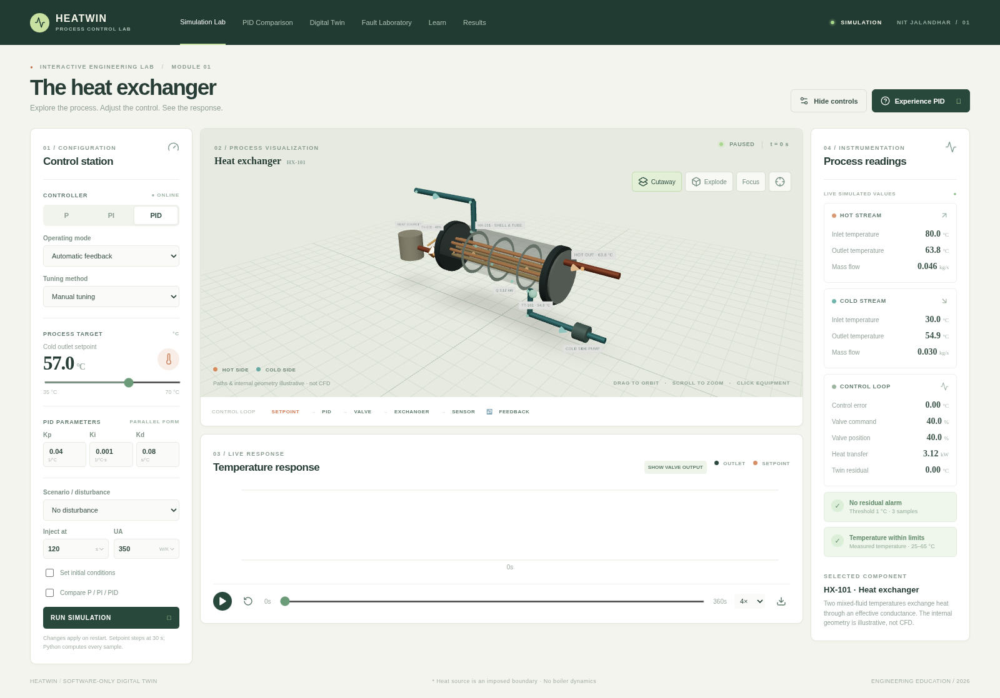

# HEATWIN — Interactive Heat Exchanger Control Laboratory

HEATWIN is a software-only educational process-control project for NIT Jalandhar. Its browser laboratory connects an illustrative Three.js exchanger to the existing Python heat exchanger, P/PI/PID controller, identified digital twin and residual monitor. All temperatures, flows and results are simulated; there is no physical plant or validated safety system.



## Start the laboratory

Python 3.12 and Node.js 22 or later are the tested targets. Run the commands from the repository root in two terminals:

```bash
git clone https://github.com/shanmukhdatta/HEATWIN.git
cd HEATWIN
python -m venv .venv
source .venv/bin/activate  # Windows: .venv\Scripts\activate
pip install -r requirements-lock.txt
pip install --no-deps .
python -m uvicorn heatwin.api:app --host 127.0.0.1 --port 8011
```

```bash
cd HEATWIN/frontend
npm ci
npm run dev
```

Open the local address printed by Vite (normally `http://localhost:5173`). The frontend proxies `/api` to `127.0.0.1:8011`. FastAPI documentation is available at `http://127.0.0.1:8011/docs`. The old `app.py` Streamlit interface is retained temporarily as a legacy entry point while full feature parity is reviewed; the React application is the primary interface.

## Use the lab

1. Drag to orbit, scroll to zoom, and pan using the mouse. Toggle **Cutaway** to expose the tube bundle, **Explode** to move the end caps, or reset the camera. Select equipment and use **Focus** to inspect it.
2. Press play. The timeline, readings, process view and chart follow the same recorded simulation time. Pause, reset or seek; playback speed changes simulated seconds per wall-clock second.
3. Select a controller, change gains, a setpoint or initial conditions, and choose **Apply & restart**. The setpoint change occurs at 30 simulated seconds. Configuration changes intentionally restart the run instead of changing a running numerical state. Manual mode uses a specified valve command rather than feedback control.
4. Enable P/PI/PID comparison and rerun for matched initial conditions and disturbances. Switch the 3D trajectory or inspect the comparison table. Switch the chart to valve output to see command and actual actuator position.
5. Choose a disturbance or fault and an injection time, then rerun. The residual alarm is an anomaly indication, not fault classification. Open **Digital Twin** or **Learn** for interpretation and guided steps. Export the current trajectory as CSV.

The source/boiler and pump are illustrative boundary equipment, not modeled boiler or pump dynamics. The visible tube bundle, baffles, streamlines, interpolated colors and flow paths explain the process; they are **not CFD results**. The real plant model contains only two well-mixed thermal states and a valve state. Valve position, temperature, flow, heat duty and alarm indicators use Python simulation samples.

## Architecture and model

```text
React controls → FastAPI /api/run → Python plant + PID + identified twin
                                         ↓ timestamped samples
3D process / instruments ← shared playback clock → charts, metrics and CSV
```

The API calculates a deterministic complete trajectory per request. The browser replays it; no frontend code calculates the exchanger dynamics. Comparison mode runs three independent simulations with common initial state, setpoint, perturbation, sample time and seed. The twin is an open-loop FOPDT model fitted to a separate nominal step; it does not know hidden plant states or unmeasured disturbances. A residual exceeding 1 °C for three samples triggers an anomaly alarm; the measured temperature also triggers a separate illustrative 25–65 °C limit alarm.

The plant assumes constant properties, fixed holdup, perfect mixing, no heat loss, and no phase change:

```text
rho Vc cp dTc/dt = mc cp (Tc,in − Tc) + UA (Th − Tc)
rho Vh cp dTh/dt = mh cp (Th,in − Th) − UA (Th − Tc)
tau_v dx/dt = clip(u,0,1) − x
mh = mh_min + (mh_max − mh_min) clip(x,0,1)
```

The controller supports P, PI and PID, filtered derivative on measurement, output limits and conditional integration. Gain units are fraction/°C, fraction/(°C·s) and fraction·s/°C. Full assumptions, tuning formulas, units and validation are in [engineering notes](docs/engineering.md).

## Experiments and verification

```bash
python -m pytest -q
ruff check .
ruff format --check .
python -m scripts.experiments
python -m scripts.studies
cd frontend
npm run format:check
npm test
npm run build
npm run e2e
```

Playwright starts both local servers if they are not running. Install a Playwright Chromium browser with `npx playwright install --with-deps chromium` when no system Chromium is available. Set `PLAYWRIGHT_CHROMIUM_EXECUTABLE_PATH` to use another installed Chromium. Tests and builds require a network connection for the initial dependency installation; the app has no paid API dependency.

The baseline manual-gain setpoint test has P / PI / PID IAE of **740.58 / 162.30 / 162.35 °C·s**, with final errors **1.340 / 0.0081 / 0.0078 °C**. On a held-out downward valve step, first-order and FOPDT RMSE are **0.356 / 0.353 °C**. In individual simulated faults the residual alarm detects sensor bias in 2 s, drift in 114 s and flow and UA changes in 7 s; it misses the demonstrated stuck valve. Ten normal-noise seeds produced no alarms, which is not a statistical guarantee. See [study results](results/studies/summary.json) for assumptions and complete metrics.

Screenshots captured from the running application: [cutaway](docs/screenshots/cutaway.png), [PID controls](docs/screenshots/pid.png), [comparison](docs/screenshots/comparison.png), [digital twin](docs/screenshots/twin.png), [fault](docs/screenshots/fault.png), [guided learning](docs/screenshots/learning.png), and [mobile](docs/screenshots/mobile.png).

## Limitations

This is a local educational prototype, not an industrial digital twin or safety system. There are no real measurements, pump or boiler dynamics, spatial temperature fields, or CFD. The residual cannot distinguish faults from model mismatch, and the included stuck-valve case demonstrates a missed detection. Finite-horizon simulations and local linearization do not prove robust global stability. Simulation starts at a calculated equilibrium unless custom initial temperatures and valve position are supplied; live parameter changes without restarting are not yet supported. The tutorial provides guided instructions rather than enforcing each activity, and twin comparison uses a shared scene and overlaid traces rather than two independent 3D views. Camera focus and reset use a short interpolation; the tutorial does not automatically move the camera. Large Three.js/chart bundles may affect startup on slower networks. See [completion checklist](COMPLETION_CHECKLIST.md) for verified and remaining items.
